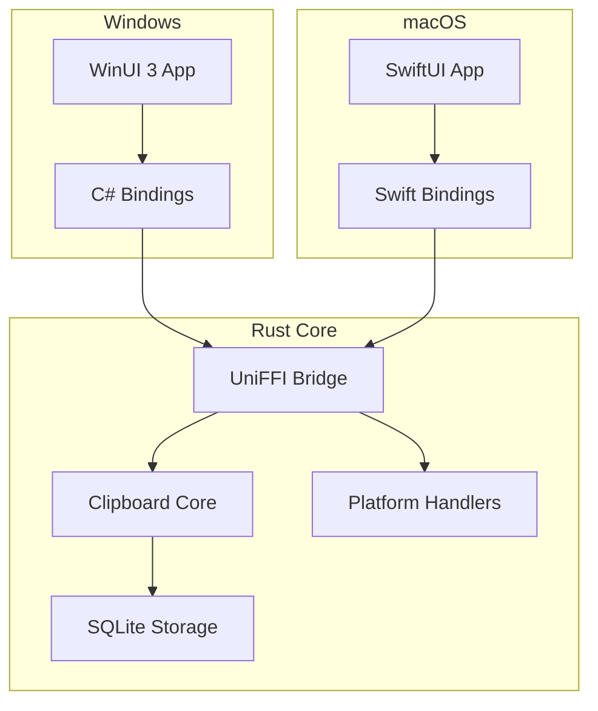

# Clipcy

A fast, modern clipboard manager built with a hybrid architecture: Rust backend + native UI.

## Architecture

Clipcy uses a "Logic Sandwich" architecture:
- **Rust Backend**: Core clipboard logic, SQLite storage, system hooks
- **Native UI**: Platform-specific native UI (WinUI 3 on Windows, SwiftUI on macOS)
- **UniFFI Bridge**: Connects Rust to native languages (C#, Swift)



## Features

- Clipboard history with text, images, and files support
  - Image thumbnails displayed directly in the history list
  - Pinned items are ordered by pin time (newest first); pasted regular items move to the top of history
- Global hotkey (default: `Alt+V`)
- System tray integration with icon and context menu
- SQLite storage
- Native settings UI
- Light/Dark/System theme support
- Auto-start on boot
- Context menu-style popup with acrylic/mica backdrop (Windows 11)
- Borderless floating window (always on top, no taskbar entry)
- Multi-monitor support (appears on cursor's monitor)
- Keyboard-first navigation:
  - First item auto-selected on open
  - Up/Down arrows to navigate
  - Enter to paste selected item
  - Ctrl+1 through Ctrl+0 to paste the first ten displayed regular items
  - Ctrl+Alt+the displayed pin key to paste immediately; prefix shortcuts use a second key
  - Escape to close
  - Auto-focus search on typing
- Auto-hide on click outside or focus loss
- Screen boundary detection
- Preview panel on hover/focus:
  - Larger preview of clipboard content (text, images, files)
  - High-resolution image previews
  - Intelligent positioning (adapts to available space, screen edges, and taskbar)
  - Content-specific metadata (dimensions, file size, character/word count)
  - Auto-dismisses when focus moves away
  - Shows copy time, source application, and pin status

## Platform Support

| Platform | UI Technology | Status |
|----------|--------------|--------|
| Windows | WinUI 3 (C#) | ✅ Implemented |
| macOS | SwiftUI | 🔜 Planned |
| Linux | GTK4 | 🔜 Planned |

---

## Windows

### Requirements

#### Development
- Windows 10 version 1809+ (build 17763)
- [Rust](https://rustup.rs/) 1.75+
- [.NET 8 SDK](https://dotnet.microsoft.com/download/dotnet/8.0)
- Visual Studio 2022 with "Windows App SDK" workload

#### Runtime
- Windows 10 version 1809+ or Windows 11
- Windows App SDK Runtime (bundled)

### Quick Start

#### Using Build Script
```powershell
# Debug build
.\scripts\build-windows-ui.ps1

# Release build
.\scripts\build-windows-ui.ps1 -Release

# Clean build
.\scripts\build-windows-ui.ps1 -CleanBuild
```

#### Build Installer (Windows)
Requires Inno Setup 6 (`ISCC.exe` on PATH).

```powershell
# powershell -ExecutionPolicy Bypass -File scripts/build-windows-installer.ps1
.\scripts\build-windows-installer.ps1

# If Inno Setup is not on PATH
.\scripts\build-windows-installer.ps1 -InnoSetupPath "C:\Program Files (x86)\Inno Setup 6\ISCC.exe"
```

Outputs:
- Published app: `dist\windows\win-x64`
- Installer: `dist\installer`

### MSIX Auto-Update (WinUI)

Clipcy supports Windows auto-update via MSIX + App Installer. Packages are hosted on GitHub Releases.

#### Required Assets
MSIX needs these PNGs in `apps/clipcy-windows/Assets/`:
- `StoreLogo.png`
- `Square44x44Logo.png`
- `Square150x150Logo.png`
- `SplashScreen.png`

Generate them from `icon.ico`:
```powershell
./scripts/generate-msix-assets.ps1
```

#### Build MSIX Locally
```powershell
./scripts/build-msix-release.ps1 -Repo ORG/REPO -CertificatePath "path\to\cert.pfx" -CertificatePassword "password"
```

Outputs:
- `dist\msix\win-x64\Clipcy.msix`
- `dist\msix\win-x64\Clipcy.appinstaller`

Version comes from `Cargo.toml` (`[workspace.package].version`) and is converted to 4-part MSIX format (e.g. `0.1.0` → `0.1.0.0`).

#### GitHub Release Workflow
Workflow: `.github/workflows/release-msix.yml`

Secrets required:
- `MSIX_CERT_BASE64` (base64-encoded PFX)
- `MSIX_CERT_PASSWORD`

Run the workflow and optionally leave `version` empty to use `Cargo.toml`.

#### Publishing Steps
1. Ensure `Publisher` in `apps/clipcy-windows/clipcy-windows.csproj` and `apps/clipcy-windows/Package.appxmanifest` matches your cert subject.
2. Build/sign MSIX (local or CI).
3. Upload `Clipcy.msix` + `Clipcy.appinstaller` to GitHub Release `vX.Y.Z`.
4. Share the `.appinstaller` URL. Windows will auto-check for updates on launch.

Note: The Inno Setup installer build is separate and uses EXE publishing. The script `scripts/build-windows-installer.ps1` forces `WindowsPackageType=None` so it does not conflict with MSIX packaging.

#### Manual Build

1. **Build Rust Bridge (cdylib)**

    Or you can use any other version compatible with uniffi v0.29. Read here [uniffi-bindgen-cs](https://github.com/NordSecurity/uniffi-bindgen-cs)
   ```bash
   cargo install uniffi-bindgen-cs --git https://github.com/NordSecurity/uniffi-bindgen-cs --tag v0.10.0+v0.29.4
   ```

   ```bash
   cargo build --release -p clipcy-bridge
   # Output: target/release/clipcy_core.dll
   ```

2. **Generate C# Bindings**
   ```bash
   # Requires uniffi-bindgen-cs
   uniffi-bindgen-cs --library target/release/clipcy_core.dll --out-dir apps/clipcy-windows/Bindings
   ```

3. **Build WinUI 3 App**
   ```bash
   cd apps/clipcy-windows 
   dotnet run
   # or for release build
   dotnet build -c Release
   ```

### Project Structure

```
clipcy/
├── apps/
│   ├── clipcy-windows/    # WinUI 3 Windows app (C#)
│   ├── clipcy-macos/         # macOS app (placeholder)
│   └── clipcy-linux/         # Linux app (placeholder)
├── crates/
│   ├── bridge/               # UniFFI bridge for native UI
│   ├── core/                 # Domain logic and ports
│   ├── storage/              # SQLite repository
│   ├── platform-windows/     # Windows platform handlers
│   └── settings-common/      # Shared settings types
└── scripts/
    └── build-windows-ui.ps1  # Windows build script
```

### Configuration

Settings are stored in `%LOCALAPPDATA%\clipcy\settings.json`:

```json
{
  "max_history_items": 100,
  "hotkey": "Alt+V",
  "theme": "system",
  "start_on_boot": true,
  "show_notifications": false,
  "show_preview_panel": true,
  "excluded_apps": []
}
```

Database: `%LOCALAPPDATA%\clipcy\clipcy.db`

### Usage

1. Run `Clipcy.exe`
2. Icon appears in system tray
3. Press `Alt+V` to open clipboard history
4. Click an item to paste it
5. Right-click tray icon for menu (Settings, Clear History, Exit)

### Troubleshooting

#### Hotkey not working
- Check if another app is using the same hotkey
- Modify hotkey in Settings

#### Tray icon not visible
- Click the `^` arrow in Windows taskbar to see hidden icons
- Drag the icon to the taskbar

#### App crashes on startup
- Ensure .NET 8 Runtime is installed
- Check logs in `%LOCALAPPDATA%\clipcy\logs\`

---

## macOS

*Coming soon - SwiftUI implementation planned*

### Planned Features
- Menu bar app with `NSStatusItem`
- `MenuBarExtra` for macOS 13+
- Floating `NSPanel` for popup

---

## Linux

*Coming soon - GTK4 implementation planned*

---

## Development

### Hexagonal Architecture

The project follows Hexagonal (Ports & Adapters) Architecture:

- **Core**: Domain models, ports (traits), application services
- **Adapters**: Platform-specific implementations, storage (SQLite)
- **Bridge**: UniFFI FFI layer for native UI binding
- **Apps**: Platform-specific native UI applications

### Adding a New Platform

1. Create platform handlers in `crates/platform-{os}/`
2. Implement core traits (ClipboardMonitor, HotkeyHandler, etc.)
3. Build the bridge: `cargo build -p clipcy-bridge`
4. Generate bindings for your language (Swift, Kotlin, etc.)
5. Create native UI app in `apps/clipcy-{os}/`

---

## License

MIT
