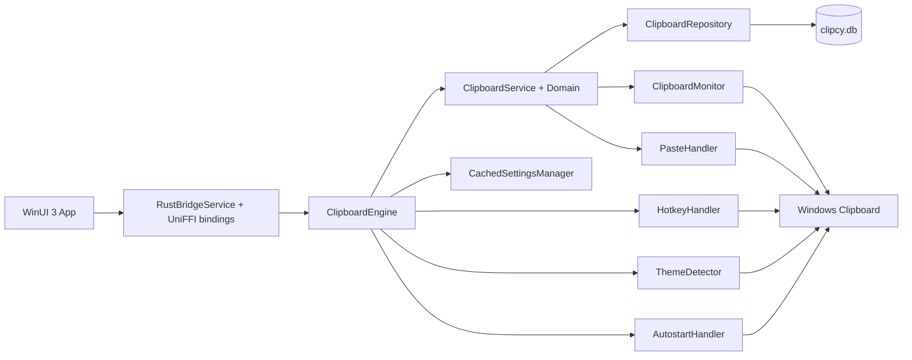
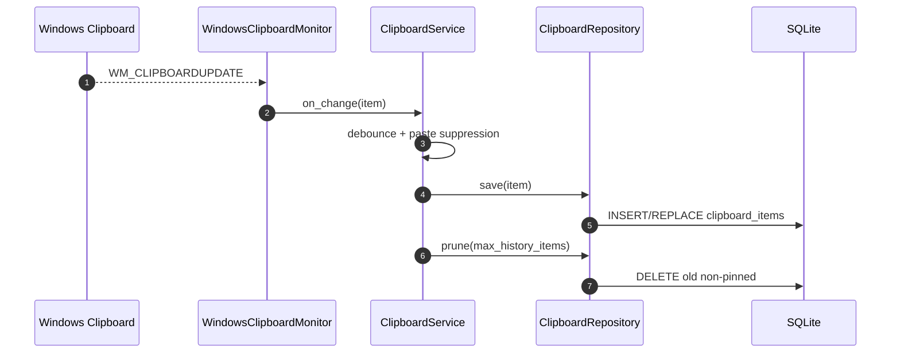
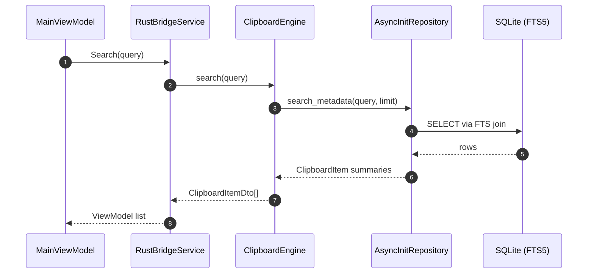
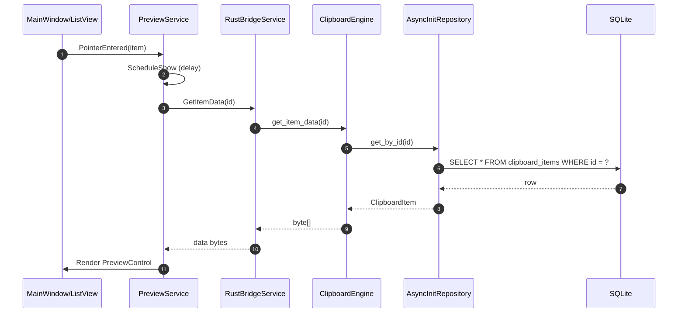
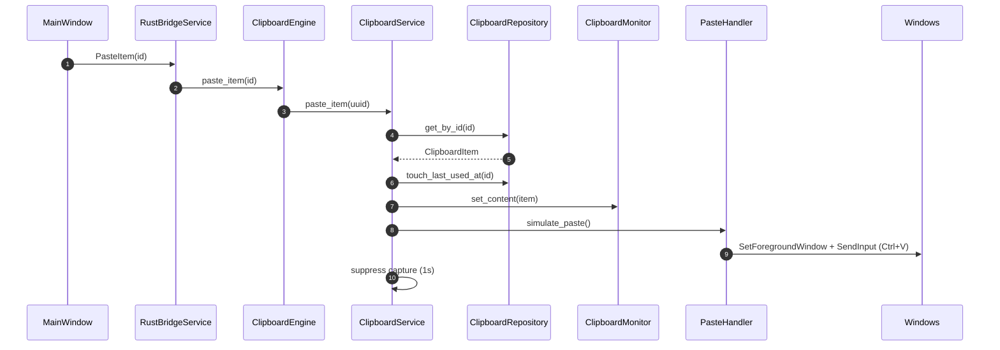

# Clipcy Development

This document explains the project architecture and how the app works end-to-end for each use case.

## Architecture overview

Clipcy follows a logic-sandwich (hexagonal / ports-and-adapters) architecture:

- Rust core defines domain models and application services with no UI or OS dependencies.
- Adapters implement platform-specific behavior (Windows clipboard, hotkeys, paste, theme, autostart).
- Storage is a SQLite repository with full-text search.
- A UniFFI bridge exposes the core to native UI apps.
- The Windows UI is a WinUI 3 app that talks to the bridge.

## Repository layout

- `crates/core/`: domain models, ports (traits), and application services.
- `crates/storage/`: SQLite repository and async initialization wrapper.
- `crates/platform-windows/`: Windows clipboard monitor, hotkey, paste, theme, autostart, history import.
- `crates/bridge/`: UniFFI interface, DTOs, and `ClipboardEngine`.
- `crates/settings-common/`: settings schema + cached settings manager.
- `apps/clipcy-windows-ui/`: WinUI 3 UI (MainWindow, SettingsWindow, tray, preview).

## Core runtime components

### Domain and application (Rust)

- `crates/core/src/domain/clipboard_item.rs`: `ClipboardItem` model and content parsing.
  - Content types: Text, RichText, Html, Image, Files.
  - Preview text is derived per type (first non-empty line or table summary).
  - `searchable_text()` builds a search index string with content, aliases, and keywords.
- `crates/core/src/application/clipboard_service.rs`: core service.
  - Debounces clipboard changes (300 ms) to reduce duplicates.
  - Suppresses captures for 1s after paste to avoid re-ingesting pasted content.
  - Saves items, prunes history, and exposes search/paste/delete APIs.
- `crates/core/src/application/app_controller.rs`: orchestration layer for a native Rust UI.
  - Not used by the WinUI app, but useful for other native frontends.

### Storage (SQLite)

- `crates/storage/src/sqlite_repository.rs`:
  - Schema includes metadata (preview, thumbnail, source app, created_at, last_used_at, pinned).
  - Uses `content_hash` to deduplicate text entries only.
  - Uses FTS5 (`clipboard_items_fts`) for search.
  - `get_all_metadata()` returns summaries for fast list rendering.
  - Ordering: pinned first, then `last_used_at` descending.

### Settings

- `crates/settings-common/src/lib.rs`: settings schema and storage.
  - File: `%LOCALAPPDATA%\clipcy\settings.json`.
  - `CachedSettingsManager` returns defaults immediately and loads in background.
  - Some fields (excluded apps, notifications, preview panel) are persisted but not enforced yet.

### Platform adapters (Windows)

- `crates/platform-windows/src/clipboard.rs`:
  - Hidden window + `AddClipboardFormatListener` to capture changes.
  - Format priority: Files (unless it is a temp screenshot) -> Image -> HTML table -> Text table -> HTML fallback -> RTF -> Text.
  - Extracts source app name and icon from the foreground process.
  - Writes content back to the clipboard for paste (text, image, files, HTML).
- `crates/platform-windows/src/hotkey.rs`: global hotkey registration in a dedicated message loop.
- `crates/platform-windows/src/paste.rs`: restores previous foreground window and simulates Ctrl+V.
- `crates/platform-windows/src/theme.rs`: registry watcher for system theme changes.
- `crates/platform-windows/src/autostart.rs`: scheduled task with registry fallback.
- `crates/platform-windows/src/clipboard_history.rs`: imports Windows clipboard history on first run.

### Bridge (UniFFI)

- `crates/bridge/src/lib.rs`: `ClipboardEngine` + DTOs.
  - Owns a tokio runtime, settings manager, repository, and platform handlers.
  - Starts background initialization and emits events to UI via `UiCallback`.
- `crates/bridge/src/clipcy_core.udl`: UniFFI interface definition.
- `apps/clipcy-windows-ui/Bindings/clipcy_core.cs`: generated bindings.

### Windows UI (WinUI 3)

- `apps/clipcy-windows-ui/App.xaml.cs`: app entry point, creates `RustBridgeService` and windows.
- `apps/clipcy-windows-ui/Services/RustBridgeService.cs`: wrapper around `ClipboardEngine`.
- `apps/clipcy-windows-ui/MainWindow.xaml(.cs)`: popup history window and keyboard handling.
- `apps/clipcy-windows-ui/Services/WindowService.cs`: borderless, always-on-top, positioned at cursor.
- `apps/clipcy-windows-ui/Services/TrayService.cs`: system tray + hotkey handling.
- `apps/clipcy-windows-ui/Services/PreviewService.cs`: hover preview popup with async full-data load.
- `apps/clipcy-windows-ui/Services/ThemeManager.cs`: WinUI theme handling (system/light/dark).

## Runtime lifecycle (startup to ready)

1. `App.OnLaunched` creates `RustBridgeService` and calls `Initialize()`.
2. `RustBridgeService` creates `ClipboardEngine` with db path `%LOCALAPPDATA%\clipcy\clipcy.db` and calls `Start()`.
3. `ClipboardEngine` starts a background thread to:
   - Ensure the db directory exists.
   - Start `AsyncInitRepository` (SQLite init in the background).
   - Load cached settings.
   - Create `ClipboardService` and start monitoring.
   - Register the hotkey.
   - Start theme detection (if system theme is selected).
   - Import Windows clipboard history on first run.
4. UI initializes `MainWindow` (hidden), `TrayService`, and `ThemeManager`.

## Data model and storage details

- `ClipboardItem` includes:
  - `id` (UUID), `content_type`, `data` (raw bytes), `preview`, `thumbnail`.
  - `source_app` and `source_app_icon` (Windows only today).
  - `created_at`, `last_used_at`, `pinned`.
- `search_text` is precomputed from `searchable_text()` and stored in SQLite for FTS.
- Text deduplication:
  - Only text items are deduplicated by `content_hash`.
  - If a duplicate is pinned, the new item inherits `pinned = true`.
  - The old entry is deleted so the new one appears at the top.

## Use cases

### 1) Capture clipboard changes

Flow:

1. Windows posts `WM_CLIPBOARDUPDATE` to the hidden monitor window.
2. `WindowsClipboardMonitor.get_current_item()` reads the clipboard with format prioritization.
3. `ClipboardService` receives the item, debounces for 300 ms, and ignores events during paste suppression.
4. The item is saved to SQLite and the history is pruned to `max_history_items`.

Diagram:

Key code:

- `crates/platform-windows/src/clipboard.rs`
- `crates/core/src/application/clipboard_service.rs`
- `crates/storage/src/sqlite_repository.rs`

### 2) Show history popup (hotkey or tray)

Flow:

1. Global hotkey triggers in Rust (`WindowsHotkeyHandler`).
2. `ClipboardEngine` emits `BridgeEvent.HotkeyTriggered` to C#.
3. `TrayService` handles the event and calls `MainWindow.ShowAtCursor()`.
4. `WindowService` saves the previous foreground window, positions the popup, and activates it.
5. `MainWindow` refreshes history via `MainViewModel.RefreshHistoryAsync()`.

Key code:

- `crates/platform-windows/src/hotkey.rs`
- `crates/bridge/src/lib.rs`
- `apps/clipcy-windows-ui/Services/TrayService.cs`
- `apps/clipcy-windows-ui/Services/WindowService.cs`
- `apps/clipcy-windows-ui/ViewModels/MainViewModel.cs`

### 3) Search history

Flow:

1. User types in the search box.
2. `MainViewModel.Search()` calls `ClipboardEngine.search(query)`.
3. `SqliteClipboardRepository` queries FTS5 with strict and relaxed token sets.
4. Results are returned as metadata only and shown in the list.

Diagram:

Key code:

- `apps/clipcy-windows-ui/ViewModels/MainViewModel.cs`
- `crates/bridge/src/lib.rs`
- `crates/storage/src/sqlite_repository.rs`

### 4) Preview an item (hover/focus)

Flow:

1. Pointer enters a list item or it gains focus.
2. `PreviewService` schedules a delayed popup and creates `PreviewData`.
3. `PreviewData.LoadFullData` calls `ClipboardEngine.get_item_data(id)` on demand.
4. The preview popup positions itself next to the list item and renders content.

Diagram:

Key code:

- `apps/clipcy-windows-ui/Services/PreviewService.cs`
- `apps/clipcy-windows-ui/Services/PreviewData.cs`
- `crates/bridge/src/lib.rs`

### 5) Paste a selected item

Flow:

1. User clicks an item or presses Enter.
2. UI hides the popup and calls `ClipboardEngine.paste_item(id)`.
3. `ClipboardService` loads the item, updates `last_used_at`, sets clipboard content, and triggers paste.
4. `WindowsPasteHandler` restores focus to the previous window and sends Ctrl+V.
5. A 1s suppression window prevents re-capture of the paste operation.

Diagram:

Key code:

- `apps/clipcy-windows-ui/MainWindow.xaml.cs`
- `crates/core/src/application/clipboard_service.rs`
- `crates/platform-windows/src/paste.rs`

### 6) Pin or unpin an item

Flow:

1. User presses Ctrl+P or uses the context menu.
2. UI calls `ClipboardEngine.set_pinned(id, pinned)`.
3. SQLite updates the `pinned` flag.
4. History is refreshed (pinned items are ordered first).

Key code:

- `apps/clipcy-windows-ui/MainWindow.xaml.cs`
- `crates/bridge/src/lib.rs`
- `crates/storage/src/sqlite_repository.rs`

### 7) Delete a single item

Flow:

1. User presses Delete or uses the context menu.
2. UI calls `ClipboardEngine.delete_item(id)`.
3. SQLite deletes the row and a HistoryUpdated event is emitted.

Key code:

- `apps/clipcy-windows-ui/MainWindow.xaml.cs`
- `crates/bridge/src/lib.rs`
- `crates/storage/src/sqlite_repository.rs`

### 8) Clear history

Flow:

1. User clicks Clear History (tray menu or UI).
2. UI calls `ClipboardEngine.clear_history()`.
3. SQLite deletes all non-pinned items.

Key code:

- `apps/clipcy-windows-ui/Services/TrayService.cs`
- `crates/bridge/src/lib.rs`
- `crates/storage/src/sqlite_repository.rs`

### 9) Update settings

Flow:

1. `SettingsWindow` edits a `SettingsViewModel`.
2. UI calls `RustBridgeService.SaveSettings()`.
3. `ClipboardEngine.save_settings()` persists the file and applies changes:
   - Autostart enable/disable.
   - Re-register hotkey.
   - Theme change (Rust side).
4. WinUI applies its own theme changes via `ThemeManager.SetTheme()`.

Notes:

- `show_notifications`, `show_preview_panel`, and `excluded_apps` are currently persisted but not enforced.

Key code:

- `apps/clipcy-windows-ui/SettingsWindow.xaml.cs`
- `crates/bridge/src/lib.rs`
- `crates/settings-common/src/lib.rs`

### 10) First-run clipboard history import

Flow:

1. `ClipboardEngine` detects `settings.first_run == true`.
2. It calls `import_system_clipboard_history()` on a background thread.
3. Imported items are saved to SQLite and the flag is set to false.
4. A notification event is emitted (tray shows it if enabled).

Key code:

- `crates/bridge/src/lib.rs`
- `crates/platform-windows/src/clipboard_history.rs`

### 11) Tray actions and lifecycle

Flow:

1. Tray icon is created at startup.
2. Left click shows the popup.
3. Context menu supports Show, Clear History, Settings, Exit.
4. Exit disposes the tray and stops the Rust engine.

Key code:

- `apps/clipcy-windows-ui/Services/TrayService.cs`
- `apps/clipcy-windows-ui/App.xaml.cs`

### 12) Theme changes

Flow:

1. `ThemeManager` uses WinRT `UISettings` and registry reads to detect changes.
2. Windows and menus update their `RequestedTheme`.
3. The Rust bridge also emits `BridgeEvent.ThemeChanged` when configured for system theme.
   - The WinUI app does not subscribe to this event today; it uses `ThemeManager` instead.

Key code:

- `apps/clipcy-windows-ui/Services/ThemeManager.cs`
- `apps/clipcy-windows-ui/Services/ThemeListener.cs`
- `crates/platform-windows/src/theme.rs`

### 13) Autostart

Flow:

1. Settings toggle triggers `ClipboardEngine.save_settings()`.
2. `WindowsAutostartHandler` creates or deletes a scheduled task.
3. If task creation fails, it falls back to the registry Run key.

Key code:

- `crates/platform-windows/src/autostart.rs`
- `crates/bridge/src/lib.rs`

### 14) Shutdown

Flow:

1. UI calls `Application.Current.Exit()` (tray Exit).
2. `RustBridgeService.Dispose()` stops the engine and unregisters hotkeys.
3. Clipboard monitoring and theme detection are stopped.

Key code:

- `apps/clipcy-windows-ui/Services/TrayService.cs`
- `apps/clipcy-windows-ui/Services/RustBridgeService.cs`
- `crates/bridge/src/lib.rs`

## Extension points

- Add a new content type:
  - Update `crates/core/src/domain/content_type.rs` and `crates/core/src/domain/clipboard_item.rs`.
  - Extend DTO mappings in `crates/bridge/src/lib.rs`.
  - Store and search in `crates/storage/src/sqlite_repository.rs`.
  - Render in `apps/clipcy-windows-ui/Services/PreviewService.cs`.
- Add a new platform:
  - Implement ports in `crates/core/src/ports/`.
  - Create `crates/platform-{os}/` adapters.
  - Wire them into `ClipboardEngine`.
  - Build a new native UI under `apps/clipcy-{os}/`.
- Change the UniFFI API:
  - Edit `crates/bridge/src/clipcy_core.udl` and regenerate bindings.
  - Update `apps/clipcy-windows-ui/Bindings/clipcy_core.cs`.
