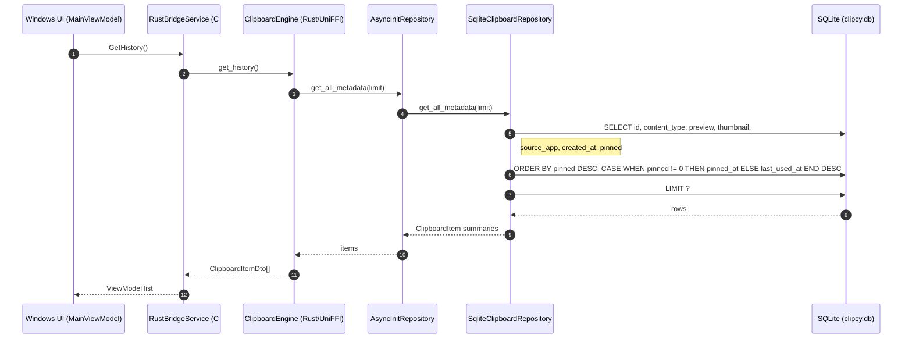
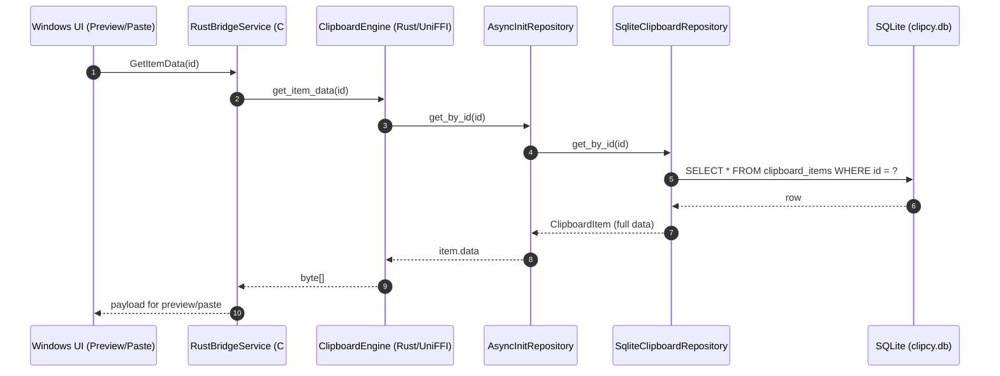

# Clipboard History Architecture

This document describes how clipboard history is retrieved from the database, how it is sorted, and how pinning works in the current Clipcy codebase.

## Retrieval Path (History List)

## Retrieval Path (Full Item Data)

## Pinning Flow

```mermaid
flowchart LR
    UI[TogglePin command]
    Bridge[RustBridgeService.SetPinned]
    Engine[ClipboardEngine.set_pinned]
    Service[ClipboardService.set_pinned]
    Repo[ClipboardRepository.set_pinned]
    Sqlite[SqliteClipboardRepository.set_pinned]
    DB[(SQLite: UPDATE pinned)]
    Refresh[BridgeEvent.HistoryUpdated]
    UIRefresh[RefreshHistory]

    UI --> Bridge --> Engine --> Service --> Repo --> Sqlite --> DB
    DB --> Refresh --> UIRefresh
```

## Sorting Rules

- History list uses metadata-only queries ordered by `pinned DESC, CASE WHEN pinned != 0 THEN pinned_at ELSE last_used_at END DESC`.
- Search orders pinned matches by pin time (newest first), then regular matches by relevance and last use.
- Full-data `get_all` uses the same `pinned DESC, CASE WHEN pinned != 0 THEN pinned_at ELSE last_used_at END DESC` ordering.
- After a successful paste, the service updates `last_used_at` and invokes its history-change callback. The bridge sends `HistoryUpdated`, refreshing the popup so a pasted regular item moves to the top of its section; pinned items keep their position. Failed pastes do not change the ordering.
- The popup partitions that list: pinned rows render in a region above unpinned rows. The regions scroll independently. Rows are 36 DIPs tall with zero item margins and compact padding. A local row template limits the gap between hover/selection backgrounds to 1 DIP. At most 3 pinned rows are visible; the popup height grows by the visible pinned region so the regular list does not shrink.

## Pinning Rules

- `pinned_at` records the time an item becomes pinned. Repeated pin requests, copying, and pasting preserve it; unpinning clears it and repinning records a new time. Existing pins use their previous `last_used_at` as a fallback because historical pin times were not stored.
- `pinned = true` prevents deletion by clear/prune (only non-pinned items are removed).
- Text deduplication preserves pin state: if an existing duplicate is pinned, the new save inherits `pinned = true`.
- Text deduplication also retains the existing pinned item's ID so its permanent quick-paste code remains valid.
- The Windows UI stores a permanent item-ID-to-numeric-code mapping in `%LOCALAPPDATA%\clipcy\pinned-shortcuts.json`. New IDs receive the greatest saved code plus one; old assignments are retained, never renumbered or recycled. The first 34 assignments use single Ctrl+Alt keys in left-hand priority order. O/P are reserved prefix branches: Enter selects a prefix's own item and a terminal letter/digit pastes its item immediately. Allocate additional codes breadth-first through O/P branches; the first 104 assignments use at most two keys. Reserving prefixes prevents new pins from delaying or changing direct shortcuts. See the Windows UI README for the complete algorithm. Ctrl+1…Ctrl+0 still paste the first ten regular rows; labels use the same mapping as keyboard shortcuts.

## Capture pause

Tray **Pause Clipcy** stops new history admission after the worker acknowledges the barrier. The native listener stops decoding new payloads immediately and, on resume, treats the current clipboard sequence as a noncapturable baseline. Copies made while paused are not imported. Existing history, paste, search, and the hotkey keep working. Pause is not saved; process restart starts capture again. The tooltip reads **Clipcy — Paused** only after acknowledgement.

Password-manager deletion is not implemented. No Bitwarden, 1Password, or NordPass clear on this machine could be tied to a specific captured generation, so there is no Settings toggle for that behavior.

## Clipboard monitoring exclusion

Settings → Behavior/Action → **Respect clipboard history exclusion** persists `respect_clipboard_exclusion`, defaulting to false for new and legacy settings. A successful save applies the policy to the running monitor without restarting it or changing pause state. A failed disk write leaves the cached setting and active policy unchanged.

When enabled, the Windows listener opens the clipboard once and checks for the registered format `ExcludeClipboardContentFromMonitorProcessing` before decoding any payload. Presence alone excludes the snapshot, regardless of the marker's bytes. The marker check and all payload readers share one clipboard-open guard; sequence changes invalidate a snapshot. When disabled, marked copies remain eligible for normal capture.

This is capture prevention for any app that supplies this marker, not password detection, vendor qualification, or after-clear deletion. It does not remove existing ordinary or pinned entries. `CanIncludeInClipboardHistory` and `CanUploadToCloudClipboard` are separate flags and are not handled by this toggle.

## Key Code References

- `crates/storage/src/sqlite_repository.rs`
- `crates/storage/src/async_init_repository.rs`
- `crates/bridge/src/lib.rs`
- `crates/core/src/application/clipboard_service.rs`
- `apps/clipcy-windows/ViewModels/MainViewModel.cs`
- `apps/clipcy-windows/Services/RustBridgeService.cs`
