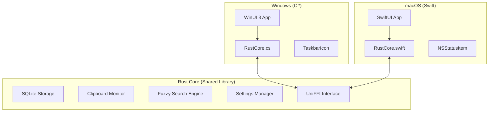

# Migration Plan: Clipcy to Native Hybrid Architecture

**Objective:** Migrate Clipcy from a Rust-native UI/Tauri architecture to a "Logic Sandwich" hybrid architecture.
**Tech Stack:**
*   **Backend:** Rust (Core Logic, SQLite, System Hooks) via UniFFI.
*   **Windows UI:** C# .NET 8 + WinUI 3 (Windows App SDK).
*   **macOS UI:** Swift + SwiftUI.

---

## 1. Architecture Overview

We are moving from "Rust does everything (including UI painting)" to "Rust does the logic, OS does the UI".



---

## 2. Detailed Feature Migration Map

This section ensures 100% feature parity with the current application.

| Feature | Current Implementation (Rust/Tauri) | New Implementation Strategy |
| :--- | :--- | :--- |
| **Clipboard Monitoring** | `platform-windows` uses `SetClipboardViewer` API. | **Rust Backend:** Keep `platform-windows` logic. Run it in a background thread spawned by `ClipboardEngine`. Send `on_clipboard_change` event via UniFFI callback. |
| **Text History** | SQLite database via `rusqlite`. | **Rust Backend:** Reuse `crates/storage` logic. Expose `get_history()` via UniFFI. |
| **Image Support** | Stored as BLOBs, rendered via custom painting. | **Rust Backend:** Return image data as `Vec<u8>`.<br>**UI (Win/Mac):** Convert byte array to `BitmapImage` / `NSImage` for display. |
| **Fuzzy Search** | Custom string matching in Rust. | **Rust Backend:** Expose `search(query: String)` via UniFFI. Reuse existing fuzzy logic. |
| **Global Hotkey** | `RegisterHotKey` in Rust main loop. | **Rust Backend:** Keep the low-level hook in Rust for consistency.<br>**Bridge:** When hotkey triggers, call `UICallback.on_hotkey()`.<br>**UI:** C#/Swift receives event -> `window.Activate()` / `NSApp.activate()`. |
| **System Tray** | `Shell_NotifyIconW` (Windows) manually managed. | **Windows UI:** Use `H.NotifyIcon.WinUI` (Community Toolkit).<br>**macOS UI:** Use native `MenuBarExtra`.<br>**Logic:** Tray actions (Exit, Settings) call Rust methods or open native windows directly. |
| **Popup Window** | Custom `CreateWindowExW` with manual painting. | **Windows UI:** `WinUI 3 Window` with `MicaBackdrop`, `ListView` with DataTemplates.<br>**macOS UI:** `NSPanel` (floating window) with `SwiftUI` List. |
| **Settings UI** | Tauri window (HTML/JS). | **Windows UI:** Native `WinUI 3 Page` with `ToggleSwitch`, `NumberBox`.<br>**macOS UI:** Native `Settings` scene in SwiftUI.<br>**Storage:** Rust manages the JSON file; UI reads/writes via `get_settings()`/`save_settings()`. |
| **Preview Panel** | Separate popup window, custom painting. | **Windows UI:** `Grid` column in the main window (Master-Detail view) or floating `Popup`.<br>**macOS UI:** `HSplitView` or Popover. |
| **Auto-start** | Registry modification in Rust. | **Windows UI:** Use `Windows.ApplicationModel.StartupTask` (standard for packaged apps) OR keep Rust Registry logic if distributing as unpackaged EXE.<br>**macOS UI:** `SMAppService` (modern) or `LoginItems`. |
| **Theming** | Custom colors based on registry check. | **Windows UI:** Native `ElementTheme` (Dark/Light/System) is built-in.<br>**macOS UI:** Native `ColorScheme` is built-in. |

---

## 3. Phase 1: Rust Backend Refactoring

**Goal:** Transform the current executable logic into a reusable dynamic library (`cdylib`) and expose it via UniFFI.

### 2.1. New Crate: `clipcy-bridge`
Instead of modifying `crates/core` heavily, we will create a wrapper crate to handle the FFI boundary.

1.  **Create Crate:** `cargo new --lib crates/bridge`
2.  **Dependencies:** `uniffi`, `thiserror`, and internal crates (`core`, `storage`, `platform-windows`*).
    *   *Note on Platform Code:* We must refactor `platform-windows` to be callable rather than owning the main loop.

### 2.2. Define the Interface (UDL or Macros)
We need to flatten the complex Rust types into simpler structures.

**Example `bridge/src/lib.rs`:**

```rust
use std::sync::Arc;
use uniffi;

#[derive(uniffi::Record)]
pub struct ClipboardItemDTO {
    pub id: String,
    pub text: String,
    pub is_image: bool,
    pub timestamp: u64,
}

#[derive(uniffi::Enum)]
pub enum BridgeEvent {
    HistoryUpdated,
    SearchComplete { items: Vec<ClipboardItemDTO> },
}

// Callback interface for the UI to implement
#[uniffi::Export(callback_interface)]
pub trait UICallback: Send + Sync {
    fn on_event(&self, event: BridgeEvent);
}

#[derive(uniffi::Object)]
pub struct ClipboardEngine {
    core: Arc<clipboard_core::AppController>, // Internal logic
}

#[uniffi::Export]
impl ClipboardEngine {
    #[uniffi::constructor]
    pub fn new(db_path: String) -> Self { ... }

    pub fn start_listening(&self, callback: Box<dyn UICallback>) {
        // Spawns the Rust background thread
        // Calls callback.on_event() when clipboard changes
    }

    pub fn get_history(&self) -> Vec<ClipboardItemDTO> { ... }
    
    pub fn search(&self, query: String) -> Vec<ClipboardItemDTO> { ... }
    
    pub fn paste_item(&self, id: String) { ... }
}
```

### 2.3. Build Configuration
Modify `Cargo.toml` to build a dynamic library.

```toml
[lib]
crate-type = ["cdylib"]
name = "clipcy_core"
```

---

## 3. Phase 2: Windows Implementation (C# / WinUI 3)

**Goal:** Create a visually stunning, native Windows 11 application.

### 3.1. Project Setup
1.  **Visual Studio 2022:** Create new project "Blank App, Packaged (WinUI 3 in Desktop)".
2.  **Dependencies:**
    *   `CommunityToolkit.Mvvm` (For MVVM pattern).
    *   `H.NotifyIcon.WinUI` (For System Tray support, as WinUI 3 lacks this native control).

### 3.2. Integration Steps
1.  **Bindings:** Run `cargo uniffi-bindgen generate src/lib.rs --language csharp`.
2.  **DLL Placement:** Configure VS Post-Build event to copy `clipcy_core.dll` to the output directory.
3.  **Initialization:**
    ```csharp
    // App.xaml.cs
    public partial class App : Application {
        public static ClipboardEngine Engine { get; private set; }
        
        protected override void OnLaunched(LaunchActivatedEventArgs args) {
            Engine = new ClipboardEngine("path/to/db");
            Engine.StartListening(new MyCallbackHandler());
        }
    }
    ```

### 3.3. UI Components
*   **Main Popup:** Use `Window` with `MicaBackdrop`. Remove title bar (`ExtendsContentIntoTitleBar = true`).
*   **List View:** Use `ListView` with a custom `DataTemplate` for clipboard items.
*   **Hotkeys:**
    *   *Option A:* Use Rust backend to detect hotkey and fire a callback to C#.
    *   *Option B:* Use C# `P/Invoke` `RegisterHotKey` (easier UI thread integration).
    *   *Recommendation:* **Option A** keeps logic centralized, but ensure the callback runs on the UI thread (`DispatcherQueue`).

---

## 4. Phase 3: macOS Implementation (Swift / SwiftUI)

**Goal:** Create a lightweight, native macOS menu bar application.

### 4.1. Project Setup
1.  **Xcode:** Create new "macOS App".
2.  **Architecture:** Use "App" lifecycle (not Storyboard).

### 4.2. Integration Steps
1.  **Bindings:** Run `cargo uniffi-bindgen generate src/lib.rs --language swift`.
2.  **Linking:** Add `libclipcy_core.dylib` to "Frameworks, Libraries, and Embedded Content".
3.  **Bridging:** Add the generated `.swift` files to the project.

### 4.3. UI Components
*   **Menu Bar:** Use `MenuBarExtra` (macOS 13+) or `NSStatusItem` (older support).
*   **Floating Window:** Create an `NSPanel` subclass for the popup (floating, frameless).
*   **List:** SwiftUI `List` or `LazyVStack`.

---

## 5. Migration Checklist

### Rust Changes
- [ ] Create `crates/bridge`.
- [ ] Define `uniffi` interface (Record structs for Items, Object for Engine).
- [ ] Implement `start_listening` to bridge `platform-windows` events to `UICallback`.
- [ ] Configure `cdylib` build profile.

### Windows App
- [ ] Initialize WinUI 3 project.
- [ ] Implement MVVM for `ClipboardItem`.
- [ ] Create `MainWindow.xaml` (The Popup) with Mica support.
- [ ] Create `SettingsWindow.xaml` (The Settings).
- [ ] Implement `TrayIcon` logic.

### CI/CD
- [ ] Update `build.yml` to build `cdylib` instead of `.exe`.
- [ ] Add steps to run `uniffi-bindgen`.
- [ ] Add C# build steps (`dotnet build`).

## 6. Key Considerations

*   **Thread Safety:** Rust callbacks run on background threads. C# and Swift UI updates **must** happen on the Main Thread.
    *   *C#:* `DispatcherQueue.TryEnqueue(() => { ... })`
    *   *Swift:* `DispatchQueue.main.async { ... }`
*   **Image Handling:** Pass images as raw bytes (`Vec<u8>` in Rust -> `byte[]` in C# -> `Data` in Swift) and convert them to `BitmapImage`/`NSImage` on the UI side.
*   **Startup:** WinUI 3 apps package differently (MSIX). Ensure "Start on Boot" logic is updated to use the Windows App SDK startup tasks or Registry entries pointing to the packaged app alias.
